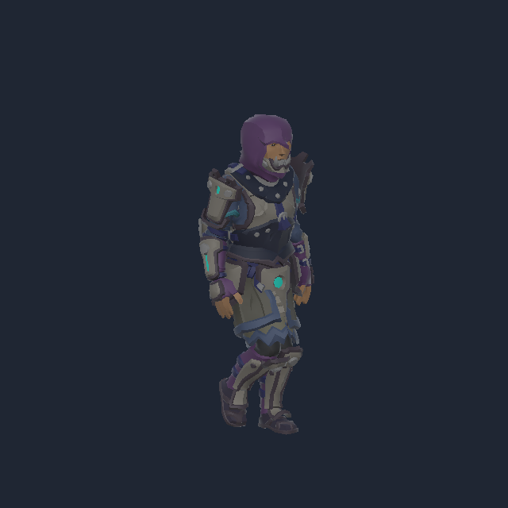

# 메인 프로젝트 에셋 설치 기록

2026년 10월 27일 · Unity 6000.6.0f1 · URP 17.6

승인한 Asset Store 무료 5팩과 보완용 Quaternius 애니메이션 2팩을 **메인 SoloProject에 임포트하고 제작자별로 정리했다.** 별도 검수 프로젝트에만 둔 상태에서 메인 설치까지 완료한 기록이다. 게임용 Animator와 플레이 기능 구현은 다음 단계다.

## 실제 위치

```text
Assets/ThirdPartyArt/
├─ Synty/
│  ├─ PolygonGeneric/       공통 재질·셰이더와 참조되는 유틸리티
│  ├─ PolygonStarter/       환경·소품·캐릭터
│  └─ SidekickCharacters/   캐릭터 프리팹과 전용 셰이더
├─ KevinIglesias/
│  └─ Human Animations/     Basic·Melee·Spellcasting, 모델과 설명서
└─ Quaternius/              UAL1·UAL2 Unity용 FBX
```

| 설치 항목 | 확보본 표시 | 기획상 용도 |
| --- | --- | --- |
| POLYGON Starter | Import 1.2.1 | 방·환경·소품 |
| Sidekick FREE Starter | Import 1.0.3 / 스토어 최신 1.0.4 | 플레이어·적 외형 후보 |
| Human Basic Motions FREE | 2.4.2 | 걷기·달리기·점프·피격 등 |
| Human Melee Animations FREE | Import 2.0.0 / 스토어 최신 2.0.2 | 근접 공격 후보 |
| Human Spellcasting Animations FREE | 1.0 | 중력 장갑 진입·유지·해제 후보 |
| Quaternius UAL1·UAL2 Standard | 기록된 OpenGameArt 배포본 | 무릎 작업·장치 조작·다운·일어서기 보완 |

Sidekick 전용 셰이더는 제작자 공식 Sidekicks Tool 1.2.8 배포본에서 원래 GUID를 유지해 추가했다. 전체 캐릭터 제작 도구와 데이터베이스는 설치하지 않았다. 버전 표시 차이와 다운로드 파일 해시는 [캐릭터·애니메이션 검수 기록](A안_캐릭터_애니메이션_검수.json) 및 [검수안](에셋_애니메이션_검수안.md)에 기록했다.

## 메인 Unity 확인 결과

| 항목 | 결과 |
| --- | --- |
| AssetDatabase 등록 경로 | 2,019개, 폴더 포함 |
| 애니메이션 클립 레코드 | 313개, 모두 humanMotion 참 |
| Humanoid 캐릭터 후보 | 10개 Avatar 유효 |
| 프리팹 로드 | 561개 |
| 프리팹 누락 스크립트 | 0건 |
| 대상 캐릭터 누락·오류 셰이더 | 0건 |
| 복사한 원본·meta 파일 검증 | 3,880개 중 누락 0개 |
| Assets 내 중복 GUID | 0건 |
| 열려 있던 씬 | SampleScene 유지, 변경 표시 없음 |

313개에는 남녀·루트 모션 변형·기준 자세 등이 포함된다. 서로 다른 게임 동작 313종을 의미하지 않는다. 원본 비교에서 변경된 파일은 Sidekick 재질 8개이며, Unity의 URP 재질 버전 5→10 및 키워드 직렬화 갱신만 확인했다. 나머지 파일은 SHA-256이 일치했다. 기존 Quaternius 폴더는 Unity의 MoveAsset으로 이동해 메인 GUID를 유지했다.



위 이미지는 메인 프로젝트에서 실제 프리팹과 걷기 클립을 읽어 렌더한 결과다. [메인 임포트 검수 JSON](메인_에셋_임포트_검수.json)에 경로·Avatar·셰이더와 씬 상태를 남겼다.

## 가져온 범위와 후속 작업

원본 내부 폴더와 meta 참조는 유지했다. 제품에서 쓰지 않는 예제 씬, Sidekick 자동 도구 다운로드 코드와 패키지 도우미는 제외했다. 프리팹과 셰이더가 참조하는 제작자 유틸리티·셰이더 검사기 및 SpineProxy는 유지했다. 임시 임포트·검사 코드는 검수 후 Assets 밖으로 보관했다.

걷기와 장갑 유지 동작의 파일은 들어 있다. 실제로 이동하면서 장갑을 유지하도록 하는 AvatarMask·Animator 레이어, 전이·피격 중단, 물체 잡기와 네트워크 동기화는 아직 구현 전이다. 구조 동작과 장치 조작의 보정도 [검수안의 잔여 항목](에셋_애니메이션_검수안.md)을 따른다.

외부 모델·텍스처·애니메이션은 로컬 `Assets/ThirdPartyArt`에 설치했으며 공개 Git에서 제외한다. 다른 PC에서는 본인 계정으로 원본을 확보한 뒤 같은 경로에 설치해야 한다. 공개 저장소에는 출처·문서·검수 메타데이터와 이미지가 포함된다.
