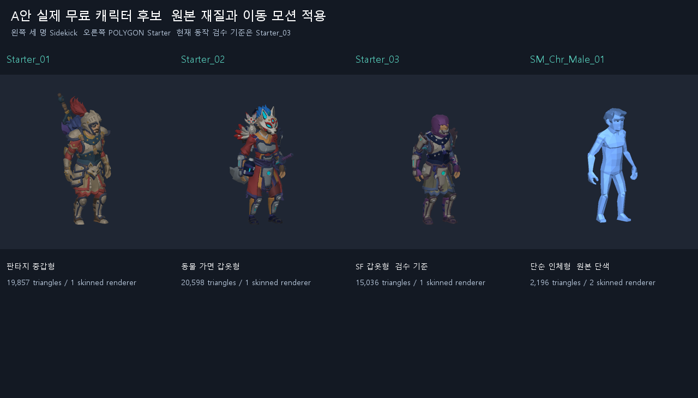
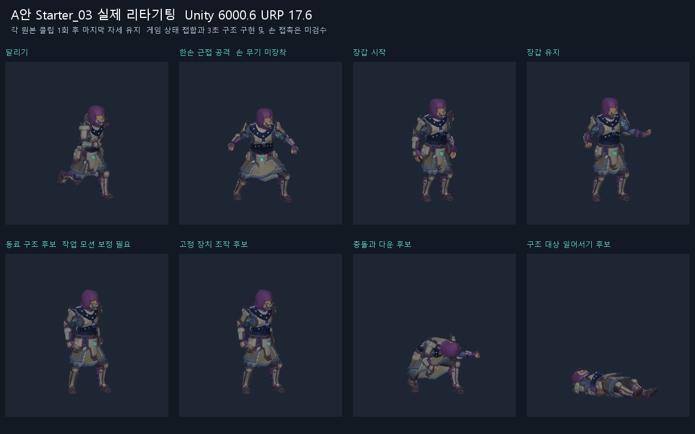
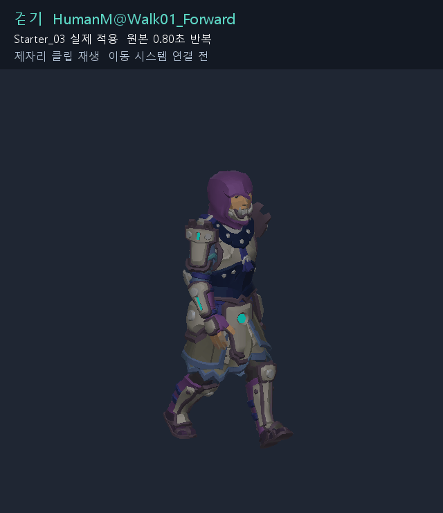
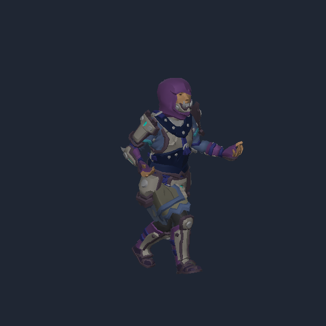
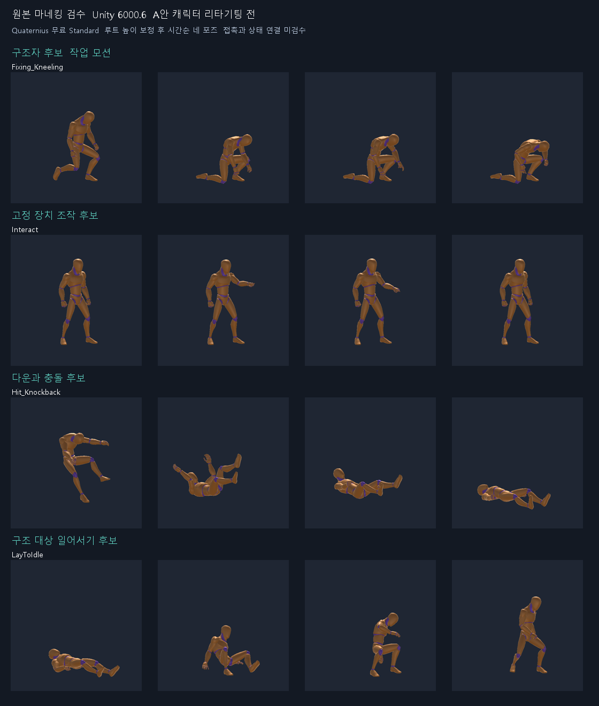
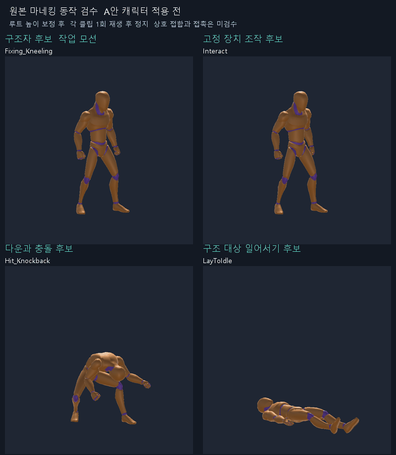
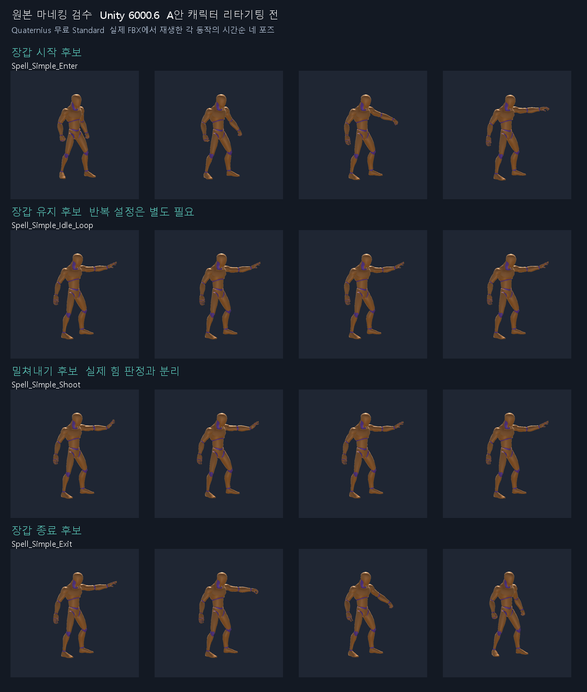

# 중력정비반 에셋과 애니메이션 검수

2026년 10월 27일 · A안 실제 캐릭터 적용 검수 · 제품 실행 검수와 구분

이동·전투·장갑은 Kevin Iglesias 무료 3팩, 구조 자세·장치 조작·다운 후 복귀는 Quaternius Standard 무료 2팩을 보완 후보로 추천한다. 초기 Basic·Melee·Crafting 추천만으로는 기획서의 모든 상태를 표현할 수 없었다. Crafting은 필수 조합에서 제외한다. 아래 조합도 전용 구조·레버·돌진 세트를 확보한 것은 아니며 재사용과 보정이 필요하다.

Quaternius 2팩은 Unity Asset Store 상품이 아니라 **제작자의 공식 무료 배포본**이다. Unity용 FBX를 내려받아 별도 Unity 6000.6.0f1 검수 프로젝트에서 확인했다. A안 Synty 외형은 유지하고 모션만 보완하는 안이다. 사용자의 로그인 완료와 약관 승인 후 Synty 2팩과 Kevin 3팩을 계정에 등록하고 다운로드했다. 별도 Unity 6000.6.0f1 URP 17.6 프로젝트에서 Starter_03에 17개 원본 동작 후보를 적용했다. 제품 Animator·상호작용·온라인 게임 실행 검수는 남아 있다.

## A안 캐릭터 실제 적용 결과

현재 동작 검수 기준은 **Sidekick Starter_03 SF 갑옷형**이다. 같은 무료 팩의 Starter_01은 판타지 중갑, Starter_02는 동물 가면 갑옷이며 Starter_04는 호박 머리 변형이다. 기본 인체 4개와 완성 프리팹 4개가 있으며, 별도 캐릭터 제작 도구 없이 이 프리팹으로 우선 검사했다. SF 갑옷을 일반 정비복이라고 설명하지 않는다. 정비복 외형은 같은 무료 부품 조합 등 별도 외형 작업이 필요하다. 최종 플레이어 외형은 사용자 시각 승인 전이다.

Sidekick 8개와 POLYGON의 남녀 인체 2개는 유효한 Humanoid Avatar로 확인했다. POLYGON의 Bean 캐릭터 4개는 이번 Humanoid 후보에서 제외했다. Starter_03은 SkinnedMeshRenderer 1개와 삼각형 15,036개이며 이것만으로 성능 목표 통과를 주장하지 않는다.

걷기는 Basic 팩의 HumanM@Walk01_Forward를 별도로 사용한다. 실제 길이 약 0.80초인 반복 클립이며, 아래는 Starter_03에 적용한 제자리 재생이다. 실제 이동 속도에 맞춘 발 접지와 걷기·달리기 전환은 제품 구현 때 검수한다.

17개 동작의 대표 포즈와 8개 동작의 연속 재생, 달리기와 장갑 유지의 상체 마스크 혼합 포즈를 확인했다. 이 혼합은 Playables 검수용이며 제품 Animator의 전이·피격 중단을 구현한 결과가 아니다. 손 무기는 부착하지 않았으므로 공격 클립과 무기 접촉을 함께 통과했다고 볼 수 없다.

- [상태별 포즈 1](Images/synty-state-poses-1.png)
- [상태별 포즈 2](Images/synty-state-poses-2.png)
- [A안 캐릭터와 실제 클립 313개 기록](A안_캐릭터_애니메이션_검수.json)

313개는 기준 자세·남녀·루트 모션·마스크 자세 등이 포함된 클립 레코드다. 313개의 서로 다른 게임 동작이라는 뜻이 아니다. 전부 humanMotion이 참인 것을 확인했지만, 17개만 Starter_03 상태별 검수 대상으로 삼았다.

## 실제 도입에서 발견한 의존성

Sidekick 기본 팩만 임포트하면 전용 셰이더 GUID 참조가 없어 Hidden/InternalErrorShader로 표시됐다. [제작자 공식 Sidekicks Tool 1.2.8](https://github.com/SyntyStudios/SidekicksToolRelease/releases/tag/1.2.8)의 Sidekicks.unitypackage에서 원래 GUID를 가진 Sidekick_ShaderGraph.shadergraph와 meta를 추가하자 Shader Graphs/Sidekick_ShaderGraph로 정상 렌더링됐다. 임의의 대체 재질로 외형을 바꾸지 않았다. 전체 제작 도구 코드와 데이터베이스는 이 검수에서 실행하지 않았다.

스토어의 최신 표시와 다운로드 후 Unity Import 버튼 표시는 달랐다. Sidekick은 최신 1.0.4에 Import 1.0.3, Melee는 최신 2.0.2에 Import 2.0.0이었다. Basic 2.4.2·Spellcasting 1.0·POLYGON 1.2.1도 기록했다. 재현할 때는 표시 하나만 믿지 않고 검수 JSON의 패키지 SHA-256과 실제 클립을 대조한다.

재현 순서는 다음과 같다.

1. 빈 검수 프로젝트를 Unity 6000.6.0f1과 URP 17.6으로 연다. 원본 경로 Assets/Synty와 Assets/Kevin Iglesias 및 임시 검수 폴더를 공개 Git 추적에서 제외한다.
2. 계정 My Assets에서 승인한 무료 5팩을 다운로드한다. 원본 씬·프로젝트 설정을 제품 프로젝트에 덮어쓰지 않는다.
3. Sidekick 프리팹 사용 시 공식 전용 셰이더 의존성을 함께 설치한다. 캐릭터 조합 기능이 필요하면 별도로 공식 도구와 데이터베이스 설치 절차를 따른다.
4. 예제 스크립트는 검수 대상과 분리한다. 최초 전체 임포트의 Basic 예제는 UGUI 의존성을 요구했으며, 모션 자체의 의존성으로 혼동하지 않는다.
5. Starter_03의 기존 Avatar를 유지하고 루트 이동을 해제해 클립을 적용한다. Quaternius 원본은 앞서 기록한 루트 높이 보정 설정도 적용한다.
6. 최종 제품 적용 전 아래 접촉·전이·온라인 검수 항목을 수행한다.

## 외형과 조합

| 용도 | 후보와 배포처 | 판단 |
| --- | --- | --- |
| 환경·소품 | [POLYGON Starter Pack](https://assetstore.unity.com/packages/3d/environments/polygon-starter-pack-art-by-synty-156819) · Synty | 다운로드·임포트 완료 · 실제 퍼즐 방 제작 적합성 미검수 · 애니메이션 팩 아님 |
| 플레이어·적 | [Sidekick FREE Starter Pack](https://assetstore.unity.com/packages/3d/characters/free-starter-pack-sidekick-modular-characters-by-synty-336970) · Synty | 8개 프리팹 Humanoid 확인 · 전용 셰이더 의존성 보완 · Starter_03 실제 동작 검수 |
| 이동 | [Human Basic Motions FREE](https://assetstore.unity.com/packages/3d/animations/human-basic-motions-free-154271) · Kevin Iglesias | 스토어 2.4.2 · 실제 파일과 Starter_03 적용 확인 |
| 전투 | [Human Melee Animations FREE](https://assetstore.unity.com/packages/3d/animations/human-melee-animations-free-165785) · Kevin Iglesias | 스토어 2.0.2 · 실제 파일과 Starter_03 적용 확인 |
| 장갑 | [Human Spellcasting Animations FREE](https://assetstore.unity.com/packages/3d/animations/human-spellcasting-animations-free-326043) · Kevin Iglesias | 스토어 1.0 · CastingEnter/Idle/Exit와 Direct1H Cast 실물·적용 확인 |
| 구조자·장치 조작 | [Universal Animation Library Standard](https://opengameart.org/content/universal-animation-library) · 제작자 quaternius 업로드 | Unity FBX 실물 확인 · 유효 Humanoid · 46클립 · 사용 후보 포즈 렌더 완료 |
| 다운·일어서기 | [Universal Animation Library 2 Standard](https://opengameart.org/content/universal-animation-library-2) · 제작자 quaternius 업로드 | Unity FBX 실물 확인 · 유효 Humanoid · 43클립 · 충돌·일어서기 포즈 렌더 완료 |

클립 수에는 기준 자세와 루트 모션 변형이 포함된다. 서로 다른 동작이 89개라는 뜻이 아니다. 제작자 홈페이지·itch.io 최신본과 OpenGameArt 배포본의 구성도 같다고 가정하지 않는다. 이번 결과는 기록한 파일 해시에 해당한다.

같은 Synty 체형과 재질을 사용하고 플레이어는 파랑·청록, 적은 붉은 경고색과 실루엣으로 구분한다. 다른 팩의 시연용 인체·몹·장비는 제품 외형에 섞지 않는다. 색 외에 아이콘과 형태도 함께 쓴다. 서로 다른 제작자의 모션 보폭과 동작 강도는 최종 캐릭터에서 맞춰야 한다.

## 기획서 상태별 대응

| 필요한 상태 | 사용할 후보 | 검수 결과와 보완 |
| --- | --- | --- |
| 대기·걷기·달리기 | Basic의 Idle01, Walk01_Forward, Run01_Forward 계열 | 실물·대표 포즈 확인 · 루트 이동을 끄고 실제 3.5m/s와 보폭 대조 |
| 점프 시작·낙하·착지 | Basic의 Jump01 - Begin, Fall01, Jump01 - Land | 실물·대표 포즈 확인 · 물리 접지로 상태 전환 · 실제 도약·착지 시점 미검수 |
| 일반 근접 1종 | Melee의 Attack1H01_R | 실물·대표 포즈 확인 · 한손 도구 접촉 보정 · 준비 0.25초·판정 0.12초·회복 0.4초는 게임 규칙 초기값이며 원본 클립 시간과 다름 |
| 피격·적 사망 | Melee의 CombatDamage01, Death01 | 실물·대표 포즈 확인 · 피격 중 잡기 취소와 다운 우선순위 연결 필요 |
| 장갑 시작·유지·종료 | Spellcasting의 CastingEnter01, CastingIdle01, CastingExit01 | 실물·대표 포즈 확인 · 상체 Mask·팔 방향·손 모양 보정 필요 |
| 장갑 대체안 | UAL1의 Rig\|Spell_Simple_Enter, Idle_Loop, Exit | 실물·대표 포즈 확인 · 0.533초·2.100초·0.433초 · 왼팔을 뻗음 · 조준 방향 보정 필요 |
| 밀쳐내기 | Spellcasting의 MagicAttackDirect1H01_R Cast 구간 | 실물·대표 포즈 확인 · 자체 체력 피해 없음 · 대체안 UAL1 Spell_Simple_Shoot 0.500초의 손바닥 내밀기 확인 |
| 경비 적 공격 | 같은 Melee 공격 재사용 | 행동·장비·색으로 구분 · 별도 몬스터 팩 불필요 |
| 돌진 예고·돌진 | 전투 대기·달리기 재사용 | 전용 돌진 세트 없음 · 예고 이펙트·몸 기울기 보완 · 호스트 Rigidbody가 이동 |
| 돌진 충돌 | UAL2의 Armature\|Hit_Knockback | 실물·대표 포즈 확인 · 0.833초 · RM 변형과 구분 · 마지막 자세와 복귀 연결 필요 |
| 플레이어 다운·대기 | Hit_Knockback 후 마지막 눕는 자세 유지 | 넘어짐 확인 · 전용 DBNO 루프는 아님 · 루트·충돌체 유지 · 적 사망과 별도 상태 |
| 구조 대상 복귀 | UAL2의 Armature\|LayToIdle | 실물·대표 포즈 확인 · 1.533초 · 누운 자세에서 일어남 · 다운 마지막 자세와 연결 미검수 |
| 동료를 구조하는 사람 | UAL1의 Rig\|Fixing_Kneeling | 실물·대표 포즈 확인 · 5.200초 · 무릎을 꿇고 바닥 쪽에 손을 뻗는 작업 동작 · 전용 구조 아님 · 3초 유지·취소·퇴장·손 접촉 보정 필요 |
| 다리 고정 장치 조작 | UAL1의 Rig\|Interact | 실물·대표 포즈 확인 · 2.000초 · 선 자세의 왼손 조작 · 버튼·고정 장치 후보 · 레버 당기기로 부르지 않음 |

기획서의 필수 퍼즐은 중량 압력판과 경첩 다리다. 사람의 레버 당기기를 새 필수 기능으로 추가하지 않는다. 다리 고정 장치를 버튼 형태로 표현하면 Interact를 사용할 수 있다는 제안이며, 최종 접촉 높이와 외형은 시각 검수 후 확정한다. 반드시 손으로 레버를 당기는 표현을 원하면 별도 미해결 항목이다.

구조 3초는 호스트가 판정하는 게임 규칙이다. 5.2초 원본을 단순히 빠르게 돌리거나 Loop 이름만 보고 반복시키지 않는다. 무릎 진입·유지·퇴장을 나누고 실제 취소를 시험해야 한다. 종전 보정 2~4시간은 근거가 부족해 확정값에서 제외한다. 전체 에셋·Animator 예산 16~24시간 안에서 우선 시험하고, 초과하면 실제 수정 범위를 보고 재산정한다.

## 실제 파일과 포즈 검수

두 Standard 팩을 별도 프로젝트에서 Human/Create From This Model로 임포트했다. 두 Avatar 모두 isValid와 isHuman이 참이며 46개·43개 클립 모두 humanMotion이 참이었다. 오류 없이 배치 검수를 마치고 8개 동작의 시간순 포즈 32장을 렌더링했다. 원본 마네킹과 Built-in 렌더러에서의 확인이며, 본 프로젝트 URP·Synty 리타기팅·레이어 혼합·멀티플레이 실행 합격을 뜻하지 않는다.

이번 임포트에서는 Loop 이름의 클립도 isLooping이 거짓이었다. 사용할 반복 클립만 Loop Time을 설정하고 시작·끝 관절 자세와 발 위치를 확인해야 한다. 모든 클립을 반복시키면 공격·다운·복귀가 반복되는 오류가 생긴다.

연속 재생에서는 LayToIdle 끝 자세가 아래로 내려가는 문제가 추가로 보였다. 별도 검수 프로젝트에서 루트 높이 Bake Into Pose, Feet 기준, XZ·회전 Bake와 applyRootMotion 해제를 적용한 뒤 복귀 끝 자세가 정상 높이로 돌아오는 것을 확인했다. 마지막 샘플에서 루트 Y는 0, 머리 Y는 약 1.537, 왼발 관절 Y는 약 0.108이었다. 발 관절 높이는 발바닥의 접지 오차가 아니며, 이 수치로 바닥 관통이나 Synty 접촉 합격을 주장하지 않는다. 적용 설정과 샘플은 파일 검수 기록에 남겼다. [Unity 루트 모션 문서](https://docs.unity.com/en-us/engine/6000.0/manual/animation-section/animation-mecanim/avatar-creationand-setup/root-motion)

연속 재생 자료는 네 원본 클립을 각자 한 번 재생하고 마지막 자세를 유지한 뒤 화면 전체를 반복한다. 네 동작을 서로 접합한 시연이 아니며, 게임의 3초 구조 구현도 아니다. 원본 모션의 시작·끝 자세와 움직임을 살펴보는 자료다.

파일별 이름·길이·Humanoid 여부·Avatar·SHA-256은 [애니메이션 파일 검수 기록](애니메이션_파일_검수.json)에 남겼다. 모델이나 원본 애니메이션은 이 기록에 포함하지 않았다.

## 제외하거나 보류한 후보

| 후보 | 이유 |
| --- | --- |
| [Crafting Mecanim FREE](https://assetstore.unity.com/packages/3d/animations/crafting-mecanim-animation-pack-free-45047) | 몸 가까이 드는 Carry 계열 · 3m 중력 잡기에 그대로 맞지 않음 |
| [Human Crafting FREE](https://assetstore.unity.com/packages/3d/animations/human-crafting-animations-free-157920) | 무료 목록은 농사·채집·낚시·채광 등 · 전용 레버·구조 근거 없음 |
| [RPG Character Mecanim FREE](https://assetstore.unity.com/packages/3d/animations/rpg-character-mecanim-animation-pack-free-65284) | 공개 목록의 Knockback·Revive는 대안 · 실물 확인한 UAL2와 중복돼 필수에서 제외 · Revive라는 이름만으로 구조자 동작이라 단정 불가 |
| [FREE 32 RPG Animations](https://assetstore.unity.com/packages/3d/animations/free-32-rpg-animations-215058) | 이동·전투 대체안 · 목록에 전용 구조·레버 없음 |
| [Free Sample Animation Set](https://assetstore.unity.com/packages/3d/animations/free-sample-animation-set-321560) | 무료 15개 목록 대조 · DBNO는 앞으로 기어가는 루프 · 구조자 동작 아님 · 손잡이 열기도 레버 전용 아님 |
| [RPG Animations Pack FREE](https://assetstore.unity.com/packages/3d/animations/rpg-animations-pack-free-288783) | 이동·공격·사다리 위주 · 필수 누락 동작 해결 근거 없음 |
| [Free Interaction Animation](https://assetstore.unity.com/packages/3d/animations/free-interaction-animation-352196) | 검색 자료에는 Reach/Idle/Pull/Exit Lever가 있으나 실제 브라우저에서 product_unavailable 확인 · 확보 가능한 무료 추천에서 제외 |
| Mixamo 검색 결과 | 공식 계정에서 해당 클립·다운로드 미확인 · 확정 목록 제외 · 제3자 미러 사용 안 함 |

## 캐릭터 적용 합격 기준

1. Synty와 Kevin 팩을 정상 계정으로 확보해 실제 버전·라이선스·클립을 기록한다. 외부 예제 스크립트·컨트롤러·프로젝트 설정을 자동 적용하지 않는다.
2. Synty Humanoid Avatar와 손가락·어깨·무릎 왜곡을 확인한다. 다른 체형까지 모두 합격했다고 일반화하지 않는다.
3. 이동·장갑·공격을 실제 체형에서 시연한다. 상체 레이어를 섞고 공격·피격·다운 때 장갑 가중치가 해제되는지 확인한다.
4. 잡은 채 이동, 잡기 중 피격, 근접 중 다운, 돌진 충돌과 복귀를 촬영한다. Rigidbody와 클립의 루트 이동이 겹치지 않는지 본다.
5. 구조자·대상을 함께 배치한다. 시작·3초 유지·피격 취소·거리 이탈·완료·중복 요청, 손 접촉·몸 관통을 검수한다.
6. 고정 장치 접촉을 정면·측면에서 확인한다. 손 접촉 오차 5cm 이내는 초기 시각 목표이며 아직 측정한 값이 아니다.
7. 게임 상태는 호스트 결과로 확정한다. 클립 종료나 Animation Event만으로 피해·구조 완료·잡기 점유를 확정하지 않는다. 지연 참가자의 표현도 확인한다.

1번과 2번의 원본 확보·Avatar 확인은 완료했다. 3번의 혼합 대표 포즈도 확인했으나 제품 Animator 검수는 아니다. 3~7의 제품 전이·접촉·온라인 검수는 구현 단계의 잔여 작업이다. 현재는 실제 캐릭터 모습과 모션 조합을 사용자에게 시각 검수받는 단계다.

## 출처와 공개 저장소

- [Basic 무료 목록](https://www.keviniglesias.com/documentation/Human%20Basic%20Motions%20FREE.pdf)
- [Melee 무료 목록](https://www.keviniglesias.com/documentation/Human%20Melee%20Animations%20FREE.pdf)
- [Spellcasting 무료 목록](https://www.keviniglesias.com/documentation/Human%20Spellcasting%20Animations%20FREE.pdf)
- [Kevin Iglesias 제작자 사이트](https://www.keviniglesias.com/)
- [Quaternius UAL1 공식 소개](https://quaternius.com/packs/universalanimationlibrary.html)
- [Quaternius UAL2 공식 소개](https://quaternius.com/packs/universalanimationlibrary2.html)
- [제작자 UAL1 배포](https://opengameart.org/content/universal-animation-library)
- [제작자 UAL2 배포](https://opengameart.org/content/universal-animation-library-2)
- [Vanilla Loop 무료 15개 실제 목록](https://docs.google.com/spreadsheets/d/1lLdKOE2V5-o6Zh3qnVMmuzn79eRrcRQeWnsq3Djdjo4/edit)

검수한 Quaternius 파일의 License.txt는 CC0 1.0을 명시한다. Asset Store 팩과 같은 조건이라고 취급하지 않는다. Public 저장소에는 검수 이미지·메타데이터·문서만 넣고 원본 모델·텍스처·애니메이션은 올리지 않는다. Unity 에셋과 임시 검사 도구는 추적 제외한 로컬 경로에서 관리한다.
